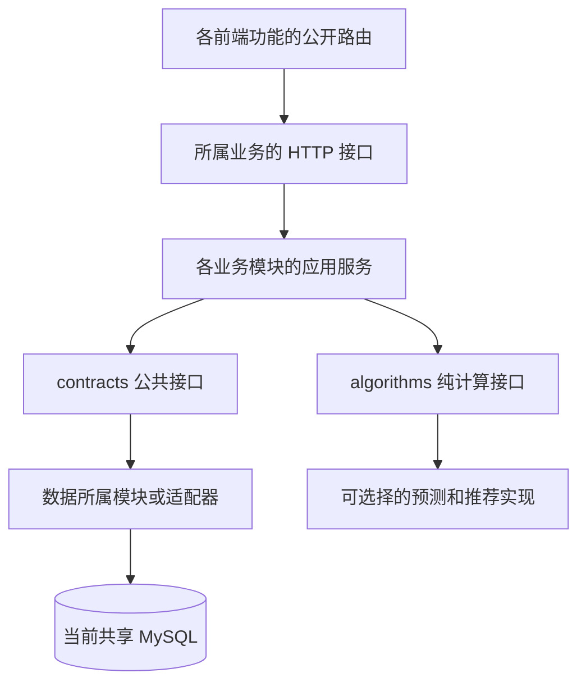

# 模块边界与替换方式

本轮将应用整理为模块化单体：算法与公共契约是独立 Maven 库，业务功能按领域组织，前端功能拥有自己的路由与页面。后端仍部署为一个进程，使用一个 MySQL 数据库，保留订单、支付和账本的本地事务。原始设计文档包保持不动。

## 代码结构

```text
pom.xml                         Maven 组合入口
contracts/                      公共接口、Actor、支付与文件存储契约，无 Spring/数据库依赖
algorithms/                     纯 Java 算法、不可变输入输出、注册选择与独立测试
server/src/main/java/.../
  auth/                         账号、角色、权限、会话和鉴权基础设施
  site/  catalog/  audit/        网点、菜品字典与价格、审计查询
  elder/                        老人、健康、家属绑定与补贴资格
  menu/                         菜谱发布及餐品库存接口
  forecast/  preparation/       预测应用编排、备餐计划
  recommendation/               饮食安全过滤、推荐编排、配置和曝光
  order/                        创建、查询、支付、退款、核销与配送
  payment/                      订单上下文的支付渠道适配器
  notice/  review/  ticket/     公告、评价、投诉工单
  nutrition/  dashboard/       营养报告、运营看板
  integration/                  跨领域报表与附件访问权限的共享 SQL 读取适配器
  common/  config/              SQL、加密、文件实现、时间及应用组装
web/src/features/               各功能的页面、routes.ts、index.ts 和测试
web/src/shared/                 公共表单类型、角色与状态页
web/src/router.ts               路由组合与统一权限守卫
```



## 跨模块交互

| 调用需求 | 公共接口 | 实现所属模块 |
|---|---|---|
| 网点营业、停餐和登录网点列表 | BookingSites / SiteDirectory | site |
| 菜品快照、分类和过敏原名称 | CatalogSnapshots | catalog |
| 老人资料、资格和配送饮食摘要 | ElderProfiles | elder |
| 菜谱、餐品锁和当前占用 | MenuCatalog | menu |
| 历史就餐、已订数量和消费信号 | OrderDemand / OrderSignals | order |
| 订单读取与资源授权 | Orders | order 的查询服务 |
| 下架后的订单异常标记 | OrderExceptions | order |
| 评价均分与推荐曝光归属 | ReviewRatings / RecommendationExposures | review / recommendation |
| 必须遵守的饮食禁忌 | DietSafety | recommendation |
| 人数预测应用能力 | Forecasts | forecast |
| 看板汇总与私有附件权限 | DashboardReports / FileReadAccess | integration |
| 文件读写与支付渠道 | PrivateFileStorage / PaymentGateway | common / payment |

业务模块不导入其他业务模块的 Service、Controller 或 Mapper。鉴权 Access/AuthPrincipal/ResourceAccess 属于共用平台接口。订单与渠道适配器属于同一交易上下文；dev/config 是组合与初始化入口。接口通过构造函数注入，SQL 具体实现可以替换为其他适配器。

原来的综合管理服务拆成账号、网点、菜品和审计；公告、评价、工单各有服务和控制器。OrderService 保留为薄应用入口，内部委派给 OrderingService、OrderQueryService、PaymentService、RefundService 和 FulfillmentService。创建订单的 READ_COMMITTED、老人锁、餐品锁和支付/退款事务继续生效。

下架操作通过 OrderExceptions 让订单模块更新订单异常，菜谱模块不直接写订单表。预测通过 OrderDemand 读取实际人数，备餐通过订单公开查询接口读取数量；营养报告通过 OrderSignals 读取历史快照。

## 算法替换

独立执行算法测试，无需 MySQL、Spring 或 `.env`：

```bash
./mvnw -B -ntp -pl algorithms -am test
```

预测接口 `ForecastAlgorithm` 接收 AttendanceSample、目标日期及停餐日期，返回 ForecastPoint。默认 `weekday_average_v1` 保留同星期均值、最近样本回退与数据不足处理；另提供 `recent_weighted_average_v1` 作为可替换实现。它们是时序统计基线，不是已经训练的机器学习模型。

推荐接口 `RecommendationAlgorithm` 接收通过安全过滤的候选、评分信号与权重区间，返回排序及评分分项。默认 `weighted_score_v1` 保留既有加权规则。算法库不读取数据库、不判断用户身份、不访问文件。

在根 `.env` 中选择已注册实现，再使用 `./scripts/service.sh restart` 整体重启项目：

```dotenv
APP_FORECAST_ALGORITHM=recent_weighted_average_v1
APP_RECOMMENDATION_ALGORITHM=weighted_score_v1
```

新增实现的步骤：

1. 在 algorithms 中实现 ForecastAlgorithm 或 RecommendationAlgorithm，提供唯一且含版本的 id，以及纯计算测试。
2. 在 server 的 AlgorithmConfiguration 中注册为对应接口的 Bean。AlgorithmSelection 收集实现，以配置选择；重复标识或未知配置会拒绝启动。
3. 跑独立算法测试、替换集成测试及业务回归，再构建发布。修改实现需要重新构建；现有选择配置需要重启，不是运行时上传插件或热切换。

算法标识随预测结果和推荐曝光持久化。V8 为推荐曝光增加 algorithm 字段；原 V1–V7 迁移没有改写。独立的 DietSafety 在推荐之前过滤，并在创建订单时再次校验；推荐实现不能通过返回未获准的餐品编号绕过规则。

文件替换时实现 PrivateFileStorage，保留不公开访问的存储键，并提供对应配置；HTTP 权限、格式校验和事务回滚清理由文件应用层负责。真实支付接入范围见 [部署文档](../deployment.md)。

## 前端扩展

每个功能在 features 下持有自己的页面和 routes.ts，通过 index.ts 导出公开路由；应用 router.ts 只负责组合和统一登录/权限守卫。新增一个功能无需修改其他功能的内部页面。

原综合管理页已拆为身份、网点、菜品和审计页面；原沟通页拆为公告、评价和工单。共享 RecordPage 与上传、图片、图表组件用于界面复用，Row/Field/Definition 类型放在 shared/records.ts，不从 Vue 组件中导入业务类型。规划和交易页面按各自工作流组织。

## 自动检查和保留的耦合

```bash
# 无数据库的算法、后端依赖/写表边界、文件适配器测试
./scripts/check-modules.sh
# 独立临时 MySQL 上的全部后端测试与干净构建
./scripts/test-server.sh clean verify
# 前端依赖约束、业务单测及构建
npm --prefix web test
npm --prefix web run build
```

ModuleBoundaryTest 检查算法/契约不引入框架和应用实现，业务模块不引用其他业务实现，命令中的静态 SQL 写入所属模块的表。前端 architecture.test.ts 检查公开入口、路由归属与共享类型依赖。它们是可执行的源码约束；动态拼接 SQL、反射等仍需要代码审核。

数据库尚未隔离：报表和附件访问放在 integration 的读取适配器；资源授权、列表展示仍有跨表读取与 SQL 条件。多个业务契约暂沿用既有 Map 数据形状，只有算法及部分公共数据使用强类型 record。它们是后续演进的明确边界，不代表每个业务已经拥有独立数据库、构建产物或独立部署能力。

若未来需要服务拆分，应先将这些读取适配器和 Map 契约换成领域 DTO/远程查询，再设计跨服务支付与订单一致性；当前保持本地事务，避免为了分进程破坏金额、库存和状态一致性。

各检查点结果见 [本轮审核与测试](../reviews/modularization.md)。


## 产品完善新增模块

`wallet` 通过 `Wallets` 契约参与订单支付/退款事务；`billing` 为实际付款人财务只读模型。`address` 自主管理家属常用地址；`messages` 通过 `Inbox` 公开发送能力。`BusinessEvent` 是纯契约，公共审计仓库发布持久事件标识，`integration` 只读跨领域状态并转成通知，`order` 和 `elder` 各自记录自己的时间线和生命周期历史。监听器同步参与原事务，失败时与业务一起回滚；没有进程内异步任务丢消息窗口。未来若拆成独立服务，应改用持久 outbox 和接收端幂等，不能直接将当前事件改成异步。

`workbench` 和 `billing` 为受授权限制的查询模型，不导入其他领域的服务实现。新增表所有权已纳入 ModuleBoundaryTest；所有前端新增领域继续以 index/routes 公开入口导入。纯算法模块新增滚动回测器，后端负责加载授权历史及限制时间区间，算法只接收类型化输入。
